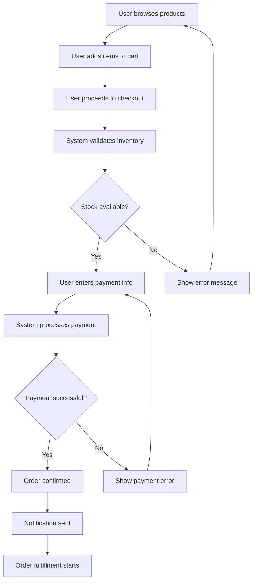

# Module 2: AI-Assisted Codebase Understanding

## Mục tiêu học tập

Sau khi hoàn thành module này, sinh viên có thể:
- Hiểu cách tiếp cận một repository mới một cách có hệ thống
- Sử dụng AI để rút ngắn thời gian tìm hiểu codebase
- Xây dựng Module Map và Business Workflow
- Giải thích code bằng AI nhưng vẫn kiểm chứng được tính chính xác
- Viết tài liệu Onboarding Notes phục vụ thành viên mới
- Áp dụng quy trình Repository Exploration trong môi trường doanh nghiệp

---

## 2.1 Repository Exploration Strategy

### Cách tiếp cận có hệ thống

Khi tiếp cận một repository mới, việc có một cách tiếp cận có hệ thống là rất quan trọng để:
- **Tiết kiệm thời gian:** Tránh lãng phí thời gian vào những phần không quan trọng
- **Hiểu sâu hơn:** Có cái nhìn toàn diện trước khi đi vào chi tiết
- **Tránh bỏ sót:** Đảm bảo không bỏ qua các phần quan trọng
- **Dễ dàng document:** Có cấu trúc rõ ràng để document lại

### Chiến lược tổng thể

1. **Top-down approach:** Bắt đầu từ overview → details
2. **AI-assisted:** Sử dụng AI để accelerate understanding
3. **Iterative:** Deep dive theo nhu cầu
4. **Documentation:** Document findings để reuse

### Quy trình 4 bước

#### Bước 1: High-level Overview (15-30 phút)

**Mục tiêu:** Hiểu bức tranh tổng quan của project

**Actions:**
- **Read README.md:** Hiểu mục đích dự án, features, và getting started
- **Check package.json/requirements.txt:** Biết dependencies và tech stack
- **Explore folder structure:** Hiểu organization và architecture pattern
- **Identify entry points:** Main file, index, app.js, server.js, etc.
- **Check documentation:** Docs folder, API docs, architecture docs

**AI-assisted prompts:**
```
Hãy phân tích overview của repository sau:
- Folder structure: [paste tree]
- Package.json/requirements.txt: [paste content]
- README: [paste key sections]

Yêu cầu:
1. Project type và purpose
2. Tech stack và main dependencies
3. Architecture pattern
4. Entry points
5. Main modules
```

#### Bước 2: Module Identification (30-60 phút)

**Mục tiêu:** Identify và understand các main modules

**Actions:**
- **Identify main modules:** Các folder/functions chính
- **Understand relationships:** Dependencies giữa modules
- **Map business concepts:** Mapping business domain → code
- **Trace imports/exports:** Hiểu flow giữa modules

**AI-assisted prompts:**
```
Hãy identify modules trong repository:
- Main folders: [list]
- Key files: [list]

Yêu cầu:
1. List main modules
2. Responsibility của từng module
3. Dependencies giữa modules
4. Entry points cho từng module
5. Suggest Module Map structure
```

#### Bước 3: Deep Dive (1-2 giờ)

**Mục tiêu:** Deep dive vào modules quan trọng

**Actions:**
- **Analyze key modules:** Modules quan trọng nhất dựa trên business value
- **Trace data flow:** Data đi qua hệ thống như thế nào
- **Understand architecture:** Pattern được sử dụng
- **Review key functions:** Functions quan trọng trong mỗi module

**AI-assisted prompts:**
```
Hãy deep dive vào module [module name]:
- Files: [list files]
- Key functions: [list]

Yêu cầu:
1. Detailed explanation của module
2. Data flow trong module
3. Key algorithms/logic
4. Design patterns used
5. Integration points với modules khác
```

#### Bước 4: Documentation (30-60 phút)

**Mục tiêu:** Document findings để reuse

**Actions:**
- **Create Module Map:** Visual representation
- **Document workflows:** Business flows
- **Create Onboarding Notes:** Cho thành viên mới
- **Update Project Understanding Report:** Tổng hợp findings

**AI-assisted prompts:**
```
Hãy giúp tôi document findings:
- Module Map: [paste]
- Workflows: [paste]
- Key insights: [paste]

Yêu cầu:
1. Create comprehensive Onboarding Notes
2. Generate Project Understanding Report sections
3. Suggest additional documentation needed
```

### Time Estimation

| Repository Size | Overview | Module ID | Deep Dive | Documentation | Total |
|----------------|----------|-----------|----------|----------------|-------|
| Small (<1K LOC) | 15 min | 30 min | 30 min | 30 min | ~2 hours |
| Medium (1K-10K LOC) | 30 min | 1 hour | 2 hours | 1 hour | ~4.5 hours |
| Large (10K-100K LOC) | 30 min | 2 hours | 4 hours | 2 hours | ~8.5 hours |
| Very Large (>100K LOC) | 1 hour | 4 hours | 8 hours | 4 hours | ~17 hours |

### Tips cho hiệu quả

1. **Don't try to understand everything:** Focus trên parts quan trọng
2. **Use AI strategically:** AI giúp accelerate, không thay thế understanding
3. **Document as you go:** Don't wait đến cuối để document
4. **Ask questions early:** Nếu stuck, ask AI hoặc team members
5. **Iterative refinement:** Understanding sẽ deep hơn qua thời gian

---

## 2.2 Repository Structure

### Cấu trúc phổ biến

#### Monolithic Structure
```
project/
├── src/
│   ├── controllers/
│   ├── models/
│   ├── services/
│   ├── utils/
│   └── config/
├── tests/
├── docs/
└── package.json
```

#### Microservices Structure
```
project/
├── services/
│   ├── user-service/
│   ├── order-service/
│   └── payment-service/
├── shared/
│   ├── common/
│   └── types/
└── docker-compose.yml
```

#### Frontend Structure (React)
```
project/
├── src/
│   ├── components/
│   ├── pages/
│   ├── hooks/
│   ├── context/
│   ├── api/
│   └── utils/
├── public/
└── package.json
```

### Sử dụng AI để phân tích structure

**Prompt template:**
```
Hãy phân tích cấu trúc repository sau:

Folder structure:
[Paste tree structure]

Package.json/requirements.txt:
[Paste content]

Yêu cầu:
1. Identify project type và tech stack
2. Explain purpose của từng folder chính
3. Identify entry points
4. Suggest architecture pattern
5. List main modules và responsibilities
```

---

## 2.3 Module Map

### Module Map là gì?
Module Map là visual hoặc textual representation của các modules trong system và mối quan hệ giữa chúng.

### Tạo Module Map

#### Bước 1: Identify Modules
```
User Module
├── User Registration
├── User Authentication
├── User Profile
└── User Permissions

Order Module
├── Order Creation
├── Order Processing
├── Order Payment
└── Order Tracking

Product Module
├── Product Catalog
├── Product Search
├── Product Inventory
└── Product Pricing
```

#### Bước 2: Map Relationships
```
User Module → Order Module (User creates orders)
Order Module → Product Module (Orders contain products)
Order Module → Payment Module (Orders need payment)
```

#### Bước 3: Visual Representation
Sử dụng tools như:
- Mermaid diagrams
- Draw.io
- Excalidraw

### Sử dụng AI để tạo Module Map

**Prompt template:**
```
Hãy tạo Module Map cho dự án sau:

Files và folders:
[List main files/folders]

Code snippets từ key files:
[Paste snippets]

Yêu cầu:
1. Identify main modules
2. Describe responsibility của từng module
3. Map relationships giữa modules
4. Suggest visual diagram (Mermaid format nếu có thể)
```

---

## 2.4 Business Workflow

### Business Workflow là gì?
Business Workflow mô tả luồng nghiệp vụ - cách system xử lý business processes từ đầu đến cuối.

### Phân tích Workflow

#### Example: E-commerce Order Flow
```
1. User browses products
   ↓
2. User adds items to cart
   ↓
3. User proceeds to checkout
   ↓
4. System validates inventory
   ↓
5. User enters payment info
   ↓
6. System processes payment
   ↓
7. Order confirmed
   ↓
8. Order fulfillment starts
```

### Sử dụng AI để phân tích Workflow

**Prompt template:**
```
Hãy phân tích business workflow cho feature sau:

Feature: [Tên feature]

Relevant code:
[Paste code từ controllers, services, etc.]

Yêu cầu:
1. Describe business workflow step-by-step
2. Identify key decision points
3. List entities involved
4. Map code functions → business steps
5. Identify edge cases và error handling
```

---

## 2.5 AI-Assisted Code Explanation

### Strategies cho Code Explanation

#### 1. Function-level Explanation
**Prompt:**
```
Giải thích function sau:

Function name: [function_name]
Code:
[Paste code]

Yêu cầu:
1. Purpose của function
2. Input parameters và ý nghĩa
3. Return value và ý nghĩa
4. Logic step-by-step
5. Edge cases
6. Dependencies
```

#### 2. Module-level Explanation
**Prompt:**
```
Giải thích module sau:

Module: [module_name]
Files:
[List files]

Key functions:
[List functions]

Yêu cầu:
1. Purpose của module
2. Main components
3. How components interact
4. Design patterns
5. Usage in system
```

#### 3. Architecture-level Explanation
**Prompt:**
```
Giải thích architecture của system sau:

Tech stack: [List]
Folder structure: [Describe]
Key files: [List]

Yêu cầu:
1. Architecture pattern
2. Component responsibilities
3. Communication patterns
4. Data flow
5. Trade-offs
```

### Tips cho effective code explanation với AI
- **Provide context:** Share relevant files, not isolated snippets
- **Ask specific questions:** Không hỏi "explain this code" quá chung
- **Request examples:** Ask for usage examples
- **Verify:** Cross-check với documentation và tests

---

## 2.6 AI Verification

### Tại sao cần verify AI?
- AI có thể hallucinate (sinh thông tin sai)
- AI có thể miss edge cases
- AI có thể misunderstand context
- Human cần đảm bảo correctness

### Verification Strategies

#### 1. Cross-reference với Documentation
- Check README, docs folder
- Compare với official documentation
- Verify với architecture diagrams

#### 2. Check Tests
- Read test files để understand expected behavior
- Run tests nếu có thể
- Check test coverage

#### 3. Manual Code Review
- Read code yourself
- Trace execution flow
- Check edge cases

#### 4. Ask AI to verify itself
**Prompt:**
```
Hãy verify explanation của bạn:

Original code:
[Paste code]

Your explanation:
[Paste AI's previous explanation]

Yêu cầu:
1. Check accuracy
2. Identify any mistakes
3. Add missing details
4. Correct if needed
```

#### 5. Ask follow-up questions
- "Are you sure about X?"
- "Can you show me where in code?"
- "What about edge case Y?"

---

## 2.7 Onboarding Notes

### Onboarding Notes là gì?
Onboarding Notes là tài liệu giúp thành viên mới hiểu project nhanh chóng.

### Structure của Onboarding Notes

#### 1. Project Overview
```
- Project name và purpose
- Tech stack
- Architecture overview
- Key features
```

#### 2. Getting Started
```
- Prerequisites
- Installation steps
- Configuration
- Running the project
```

#### 3. Codebase Structure
```
- Folder structure explanation
- Key modules
- Entry points
- Important files
```

#### 4. Development Workflow
```
- Branching strategy
- Commit conventions
- PR process
- Testing requirements
```

#### 5. Common Tasks
```
- How to add new feature
- How to fix bug
- How to run tests
- How to deploy
```

#### 6. Resources
```
- Documentation links
- Important contacts
- Team communication channels
- Useful commands
```

### Sử dụng AI để tạo Onboarding Notes

**Prompt template:**
```
Hãy tạo Onboarding Notes cho dự án sau:

Project info:
- Name: [name]
- Purpose: [purpose]
- Tech stack: [stack]

Folder structure:
[Paste structure]

Key files:
[List important files]

Yêu cầu:
1. Project overview
2. Getting started guide
3. Codebase structure explanation
4. Development workflow
5. Common tasks
6. Resources section
```

---

## 2.8 Áp dụng Quy trình Repository Exploration trong Môi trường Doanh nghiệp

### Khác biệt giữa Learning và Enterprise Environment

| Aspect | Learning Environment | Enterprise Environment |
|--------|---------------------|------------------------|
| **Documentation** | Có thể thiếu hoặc không đầy đủ | Thường có docs nhưng có thể outdated |
| **Code Complexity** | Relatively simple | Highly complex với legacy code |
| **Team Size** | Individual hoặc small team | Large teams với multiple contributors |
| **Business Context** | Simple hoặc hypothetical | Complex với nhiều business rules |
| **Time Constraints** | Flexible | Tight deadlines |
| **Stakeholders** | Self hoặc instructor | Multiple stakeholders (PM, QA, etc.) |
| **Security** | Low concern | High concern (sensitive data) |

### Quy trình Enterprise Repository Exploration

#### Phase 1: Preparation (Trước khi bắt đầu)

**1. Understand Business Context**
- Talk với product manager hoặc business analyst
- Understand business domain và terminology
- Identify key business processes
- Know stakeholders và their concerns

**2. Get Access và Permissions**
- Request appropriate access levels
- Understand security policies
- Know what data is sensitive
- Get approval cho AI tool usage

**3. Gather Initial Information**
- Project charter hoặc business requirements
- Architecture diagrams (nếu có)
- Team structure và responsibilities
- Existing documentation

**AI-assisted prompt:**
```
Hãy giúp tôi chuẩn bị cho enterprise repository exploration:

Business context:
- Domain: [describe]
- Key processes: [list]
- Stakeholders: [list]

Yêu cầu:
1. Suggest questions để ask stakeholders
2. Identify key business terms cần understand
3. List potential security concerns
4. Suggest initial documentation để review
```

#### Phase 2: Systematic Exploration (Áp dụng quy trình 4 bước)

**Với enterprise considerations:**

**Bước 1: High-level Overview với Business Lens**
- Focus trên business-critical modules
- Identify legacy vs new code
- Note integration points với external systems
- Understand data sensitivity levels

**Bước 2: Module Identification với Team Context**
- Identify team ownership của từng module
- Understand inter-team dependencies
- Note SLAs và criticality levels
- Identify technical debt areas

**Bước 3: Deep Dive với Risk Assessment**
- Focus trên high-risk/high-value modules
- Understand error handling và recovery
- Review security implementations
- Check compliance requirements

**Bước 4: Documentation với Enterprise Standards**
- Follow enterprise documentation standards
- Include security considerations
- Document team contacts và escalation paths
- Note known issues và workarounds

#### Phase 3: Validation và Alignment

**1. Validate với Team**
- Present findings cho module owners
- Get corrections và additional context
- Understand undocumented behaviors
- Learn about known issues

**2. Align với Business Requirements**
- Verify understanding với business stakeholders
- Confirm business rules và constraints
- Understand SLAs và performance requirements
- Note any gaps giữa code và requirements

**3. Document Risks và Dependencies**
- Identify technical risks
- Document critical dependencies
- Note single points of failure
- Suggest mitigation strategies

**4. Align Team Operating Model**
- Identify module owners và reviewer expectations
- Clarify khi nào cần senior review hoặc security review
- Note approvals required before touching risky modules
- Document escalation path nếu gặp undocumented behavior hoặc blocker

**5. Define Enterprise Quality Gates**
- What evidence is needed trước khi change được approved
- Which tests must pass for high-risk modules
- Whether change needs QA, product, or release-manager sign-off
- How to record verification in docs hoặc ticket

**AI-assisted prompt:**
```
Hãy giúp tôi validate và align findings:

My findings:
[Paste findings]

Team feedback:
[Paste feedback from team]

Business requirements:
[Paste requirements]

Yêu cầu:
1. Identify gaps giữa findings và reality
2. Suggest additional areas để explore
3. Highlight risks và dependencies
4. Recommend next steps
```

### Enterprise-specific Challenges

#### Challenge 1: Legacy Code
**Problem:** Large amounts of legacy code với poor documentation

**Strategies:**
- Focus trên entry points và public APIs
- Use AI to understand patterns trong legacy code
- Identify technical debt nhưng don't try to fix immediately
- Document assumptions và verify với team

**AI-assisted prompt:**
```
Hãy giúp tôi understand legacy code:

Legacy code:
[Paste legacy code]

Context:
- Age: [years]
- Original language/framework: [specify]
- Known issues: [list]

Yêu cầu:
1. Identify patterns và conventions
2. Suggest modernization opportunities
3. Note potential risks
4. Recommend areas để focus on
```

#### Challenge 2: Multiple Teams và Dependencies
**Problem:** Complex interdependencies giữa teams

**Strategies:**
- Map team ownership early
- Identify critical dependencies
- Understand communication protocols
- Document escalation paths

**AI-assisted prompt:**
```
Hãy giúp tôi map team dependencies:

Teams:
[List teams và responsibilities]

Modules:
[List modules và ownership]

Yêu cầu:
1. Map dependencies between teams
2. Identify critical integration points
3. Note potential bottlenecks
4. Suggest communication protocols
```

#### Challenge 3: Security và Compliance
**Problem:** Sensitive data và compliance requirements

**Strategies:**
- Identify sensitive data flows early
- Understand compliance requirements
- Note security implementations
- Be cautious với AI tool usage

**AI-assisted prompt:**
```
Hãy help identify security considerations:

Code:
[Paste code - sanitize sensitive data]

Context:
- Data sensitivity: [level]
- Compliance requirements: [list]

Yêu cầu:
1. Identify potential security issues
2. Note compliance concerns
3. Suggest security improvements
4. Warning: DO NOT include actual sensitive data in analysis
```

### Enterprise Documentation Standards

#### Project Understanding Report cho Enterprise

**Additional sections:**
- **Team Structure:** Teams, owners, contacts
- **SLAs và Performance:** Service levels, performance requirements
- **Security Considerations:** Data sensitivity, security measures
- **Compliance:** Regulatory requirements
- **Known Issues:** Documented bugs và workarounds
- **Escalation Paths:** Who to contact cho different issues

#### Onboarding Notes cho Enterprise

**Additional sections:**
- **Access và Permissions:** How to get access
- **Security Policies:** What not to share
- **Team Communication:** Channels, meetings, protocols
- **Incident Response:** What to do khi things break
- **Compliance Training:** Required training

### Best Practices cho Enterprise Environment

1. **Respect Security Policies**
   - Never share sensitive data với AI
   - Follow data classification guidelines
   - Get approval cho AI tool usage
   - Document AI usage decisions

2. **Collaborate với Team**
   - Don't work in isolation
   - Validate findings với module owners
   - Share knowledge với team
   - Document team-specific knowledge

3. **Focus on Business Value**
   - Prioritize business-critical modules
   - Understand business impact
   - Align với business goals
   - Communicate in business terms

4. **Manage Expectations**
   - Be realistic về time estimates
   - Communicate progress regularly
   - Flag risks early
   - Ask for help khi needed

5. **Continuous Learning**
   - Enterprise systems evolve constantly
   - Stay updated với changes
   - Regularly refresh understanding
   - Share learnings với team

### Case Study: Enterprise Repository Exploration

**Scenario:** New developer joining a large e-commerce platform

**Week 1: Foundation**
- Day 1-2: Business context, access setup, team introductions
- Day 3-4: High-level overview với AI assistance
- Day 5: Initial Module Map, identify focus areas

**Week 2: Deep Dive**
- Day 1-3: Deep dive vào order processing module (business-critical)
- Day 4: Deep dive vào payment module (security-sensitive)
- Day 5: Validation với module owners

**Week 3: Integration**
- Day 1-2: Understand integration points
- Day 3: Document workflows và dependencies
- Day 4: Create comprehensive Onboarding Notes
- Day 5: Present findings cho team, get feedback

**Week 4: Refinement**
- Day 1-2: Address feedback, refine documentation
- Day 3-4: Shadow team members, observe workflows
- Day 5: Finalize documentation, begin actual work

---

## 2.9 Ví dụ Thực tế với Sample Repository

Trong phần này, chúng ta sẽ áp dụng Repository Exploration Strategy vào **Sample Repository E-commerce Backend API**.

### Ví dụ 1: Bước 1 - High-level Overview

**Thực hiện với Sample Repository:**

**1. Read README.md**
```bash
# File: sample-repository/README.md
```

**Key Information từ README:**
- Project: E-commerce Backend API
- Tech Stack: Node.js, Express, PostgreSQL (Prisma ORM)
- Core Modules: User, Product, Order, Payment, Notification
- Purpose: Sample repository cho AI Training Course

**2. Check package.json**
```json
{
  "name": "ecommerce-backend-api",
  "dependencies": {
    "express": "^4.18.2",
    "prisma": "^5.7.0",
    "bcryptjs": "^2.4.3",
    "jsonwebtoken": "^9.0.2",
    "joi": "^17.11.0"
  }
}
```

**3. Explore Folder Structure**
```
sample-repository/
├── src/
│   ├── controllers/     # Request handlers
│   ├── routes/         # API routes
│   ├── middleware/     # Express middleware
│   └── utils/          # Utility functions
├── prisma/             # Database schema
├── tests/              # Test files
└── docs/               # Documentation
```

**4. Identify Entry Points**
- Main entry: `src/index.js`
- Database entry: `prisma/schema.prisma`

**AI-assisted Analysis:**
```
Hãy phân tích overview của sample repository:

Folder structure:
sample-repository/
├── src/
│   ├── controllers/
│   ├── routes/
│   ├── middleware/
│   └── utils/
├── prisma/
├── tests/
└── docs/

Package.json:
[paste package.json content]

Prisma schema:
[paste schema.prisma content]

Yêu cầu:
1. Project type và architecture pattern
2. Main tech stack và dependencies
3. Entry points
4. Main modules và responsibilities
5. Suggest complexity level (small/medium/large)
```

**Kết quả AI:**
- **Project Type:** RESTful API Backend
- **Architecture:** MVC Pattern (Controllers, Routes, Models)
- **Complexity:** Medium (~2000 LOC, 5 modules)
- **Main Modules:**
  - User: Authentication, profile management
  - Product: Catalog, inventory
  - Order: Order processing
  - Payment: Payment integration (placeholder)
  - Notification: Notifications (placeholder)

### Ví dụ 2: Bước 2 - Module Identification

**Thực hiện với Sample Repository:**

**1. Identify Main Modules từ Controllers:**
```
src/controllers/
├── userController.js      # User module
├── productController.js   # Product module
├── orderController.js     # Order module
├── paymentController.js   # Payment module
└── notificationController.js  # Notification module
```

**2. Map Business Concepts:**
- **User Module** → User registration, authentication, profile
- **Product Module** → Product catalog, search, inventory
- **Order Module** → Order creation, processing, tracking
- **Payment Module** → Payment processing (not implemented)
- **Notification Module** → Email notifications (not implemented)

**3. Trace Dependencies:**
```
User Module
  └── Order Module (User creates orders)
  
Order Module
  ├── Product Module (Order contains products)
  └── Payment Module (Order needs payment)
  
Product Module
  └── Order Module (Products in orders)
```

**AI-assisted Module Identification:**
```
Hãy identify modules trong sample repository:

Controllers:
- userController.js
- productController.js
- orderController.js
- paymentController.js
- notificationController.js

Routes:
- userRoutes.js
- productRoutes.js
- orderRoutes.js
- paymentRoutes.js
- notificationRoutes.js

Prisma Schema:
[paste schema.prisma]

Yêu cầu:
1. List main modules
2. Responsibility của từng module
3. Dependencies giữa modules
4. Entry points cho từng module
5. Suggest Module Map structure
```

**Kết quả AI - Module Map:**
```
┌─────────────────────────────────────────┐
│         E-commerce API System            │
└─────────────────────────────────────────┘
                    │
        ┌───────────┼───────────┐
        │           │           │
    ┌───▼───┐  ┌───▼───┐  ┌───▼───┐
    │  User │  │Product│  │ Order │
    └───┬───┘  └───┬───┘  └───┬───┘
        │           │           │
        └───────────┼───────────┘
                    │
            ┌───────▼───────┐
            │   Payment     │
            └───────────────┘
                    │
            ┌───────▼───────┐
            │ Notification  │
            └───────────────┘
```

### Ví dụ 3: Bước 3 - Deep Dive vào Order Module

**Thực hiện với Sample Repository:**

**1. Analyze Order Controller:**
```javascript
// src/controllers/orderController.js
const createOrder = async (req, res) => {
  // 1. Validate input
  // 2. Start transaction
  // 3. Check inventory
  // 4. Calculate total
  // 5. Create order
  // 6. Update stock
  // 7. Clear cart
};
```

**2. Trace Data Flow:**
```
User Request
  ↓
orderController.createOrder()
  ↓
Validate items
  ↓
Check product stock
  ↓
Calculate total amount
  ↓
Create order in database
  ↓
Update product stock
  ↓
Clear user cart
  ↓
Return order confirmation
```

**3. Understand Architecture:**
- **Pattern:** Controller-Service-Model (simplified to Controller-Model)
- **Transaction:** Uses Prisma transaction for atomicity
- **Error Handling:** Try-catch blocks
- **Validation:** Joi validation schemas

**AI-assisted Deep Dive:**
```
Hãy deep dive vào Order module trong sample repository:

Files:
- src/controllers/orderController.js
- src/routes/orderRoutes.js
- prisma/schema.prisma (Order, OrderItem models)

Yêu cầu:
1. Detailed explanation của Order module
2. Data flow trong order creation
3. Key algorithms/logic (stock check, total calculation)
4. Design patterns used
5. Integration points với User, Product, Payment modules
6. Potential issues hoặc improvements
```

**Kết quả AI:**
- **Module Purpose:** Handle order lifecycle from creation to delivery
- **Key Logic:**
  - Stock validation before order creation
  - Transaction to ensure data consistency
  - Automatic cart clearing
- **Integration Points:**
  - User: Requires authentication
  - Product: Reads product info, updates stock
  - Payment: Placeholder for payment processing
- **Potential Issues:**
  - No retry logic for payment failures
  - Limited error messages
  - No order cancellation refund logic

### Ví dụ 4: Bước 4 - Documentation

**Tạo Module Map cho Sample Repository:**

```markdown
# Module Map - E-commerce API

## User Module
**Purpose:** User authentication và profile management
**Components:**
- userController.js: register, login, getProfile, updateProfile
- userRoutes.js: /api/users/*
- auth.js middleware: JWT authentication
**Dependencies:** None (base module)
**Data Models:** User, Cart, CartItem

## Product Module
**Purpose:** Product catalog và inventory management
**Components:**
- productController.js: getProducts, createProduct, updateProduct
- productRoutes.js: /api/products/*
**Dependencies:** None
**Data Models:** Product, Category, Review

## Order Module
**Purpose:** Order processing và tracking
**Components:**
- orderController.js: createOrder, getUserOrders, updateOrderStatus
- orderRoutes.js: /api/orders/*
**Dependencies:** User, Product
**Data Models:** Order, OrderItem

## Payment Module
**Purpose:** Payment processing (placeholder)
**Components:**
- paymentController.js: Not implemented
- paymentRoutes.js: Placeholder endpoints
**Dependencies:** Order
**Data Models:** Payment

## Notification Module
**Purpose:** Email notifications (placeholder)
**Components:**
- notificationController.js: Not implemented
- notificationRoutes.js: Placeholder endpoints
**Dependencies:** User, Order
**Data Models:** Notification
```

**Tạo Business Workflow - Order Processing:**



**AI-assisted Documentation:**
```
Hãy giúp tôi document findings từ sample repository:

Module Map:
[paste module map]

Business Workflow:
[paste order workflow]

Key Insights:
- Order module uses transactions for consistency
- Payment và Notification modules are placeholders
- Authentication uses JWT with bcrypt
- Validation uses Joi

Yêu cầu:
1. Create comprehensive Onboarding Notes
2. Generate Project Understanding Report sections
3. Suggest additional documentation needed
4. Identify areas cho improvement
```

### Ví dụ 5: AI Verification

**Verify AI's Explanation:**

**AI Claim:** "Order module uses transactions to ensure data consistency"

**Verification:**
```javascript
// Check orderController.js line 20-60
const order = await prisma.$transaction(async (tx) => {
  // Transaction logic
});
```
✅ **Verified:** Code confirms transaction usage

**AI Claim:** "Payment module is not implemented"

**Verification:**
```javascript
// Check paymentController.js
router.post('/', authMiddleware, (req, res) => {
  res.status(501).json({ error: 'Not implemented yet' });
});
```
✅ **Verified:** Payment module returns 501 Not Implemented

**AI Claim:** "Product module supports search and filtering"

**Verification:**
```javascript
// Check productController.js getProducts function
const { category, minPrice, maxPrice, search } = req.query;
// Filtering logic present
```
✅ **Verified:** Search and filtering implemented

### Ví dụ 6: Onboarding Notes cho Sample Repository

**AI-assisted Onboarding Notes Generation:**
```
Hãy tạo Onboarding Notes cho sample repository:

Project Info:
- Name: E-commerce Backend API
- Purpose: Sample repository cho AI Training Course
- Tech Stack: Node.js, Express, Prisma ORM, PostgreSQL

Folder Structure:
[paste tree output]

Key Files:
- src/index.js (entry point)
- prisma/schema.prisma (database schema)
- src/controllers/ (business logic)
- src/routes/ (API endpoints)

Yêu cầu:
1. Project overview
2. Getting started guide
3. Codebase structure explanation
4. Development workflow
5. Common tasks (add feature, fix bug, run tests)
6. Resources section
```

**Kết quả AI - Onboarding Notes:**
```markdown
# Onboarding Notes - E-commerce API

## Project Overview
E-commerce Backend API sample repository designed for AI Training Course. Implements core e-commerce functionality with User, Product, Order, Payment, and Notification modules.

## Getting Started
1. Install dependencies: `npm install`
2. Setup database: `npm run db:setup`
3. Run migrations: `npm run db:migrate`
4. Seed database: `npm run db:seed`
5. Start server: `npm run dev`

## Codebase Structure
- **src/controllers/**: Request handlers for each module
- **src/routes/**: API route definitions
- **src/middleware/**: Authentication, error handling
- **src/utils/**: Validation, logging utilities
- **prisma/**: Database schema and migrations
- **tests/**: Unit and integration tests

## Development Workflow
1. Create feature branch
2. Implement controller logic
3. Add routes
4. Write tests
5. Run tests: `npm test`
6. Create pull request

## Common Tasks
- **Add new API endpoint:** Create controller function, add route, write test
- **Add database model:** Update prisma/schema.prisma, run migration
- **Debug:** Check logs in console, use debugger
- **Run tests:** `npm test` or `npm run test:coverage`

## Resources
- API Docs: http://localhost:3000/api-docs
- Prisma Studio: `npm run db:studio`
- Sample Repository Guide: SAMPLE_REPOSITORY_GUIDE.md
```

---

## 2.10 Thực hành

### Exercise 1: Repository Exploration
1. Clone một open-source repository (ví dụ: một small-to-medium project)
2. Apply exploration strategy:
   - Read README
   - Analyze structure
   - Identify modules
3. Use AI to help understand
4. Document findings

### Exercise 2: Module Map Creation
1. Chọn một module từ repository ở Exercise 1
2. Create Module Map:
   - Identify sub-components
   - Map relationships
   - Create visual diagram
3. Use AI to validate your understanding

### Exercise 3: Workflow Analysis
1. Choose a business flow (ví dụ: user registration)
2. Trace through code
3. Use AI to explain workflow
4. Verify AI's explanation
5. Document workflow

### Exercise 4: Onboarding Notes
1. Create Onboarding Notes cho repository đã chọn
2. Use AI to help generate initial draft
3. Review và refine manually
4. Get feedback từ peer nếu có thể

---

## 2.11 Resources

### Tools
- **Tree command:** `tree /F` (Windows) hoặc `tree` (Linux/Mac)
- **Code visualization:** Sourcetrail, CodeMap
- **Diagram tools:** Mermaid, Draw.io, Excalidraw

### Articles
- "How to Read Code" - Various sources
- "Codebase Navigation Strategies" - Developer blogs

### Example Repositories for Practice
- Small: Todo apps, simple APIs
- Medium: E-commerce backends, CMS systems
- Large: Open-source frameworks

---

## Quiz

1. Tại sao cần có cách tiếp cận có hệ thống khi khám phá repository mới?
2. Mô tả quy trình 4 bước trong Repository Exploration Strategy?
3. Module Map là gì và tại sao quan trọng?
4. Business Workflow là gì và cách phân tích nó?
5. Làm thế nào để verify kết quả từ AI khi giải thích code?
6. Onboarding Notes nên chứa哪些 thông tin?
7. Khác biệt giữa Learning Environment và Enterprise Environment là gì?
8. Describe 3 challenges trong enterprise repository exploration và strategies để handle chúng.
9. Time estimation cho exploring một medium-sized repository (1K-10K LOC)?
10. Best practices khi áp dụng Repository Exploration trong môi trường doanh nghiệp?

---

## Next Steps

Sau khi hoàn thành Module 2, tiếp tục với:
- **Module 3:** Project Understanding Workshop
- Áp dụng vào repository thực tế của team
